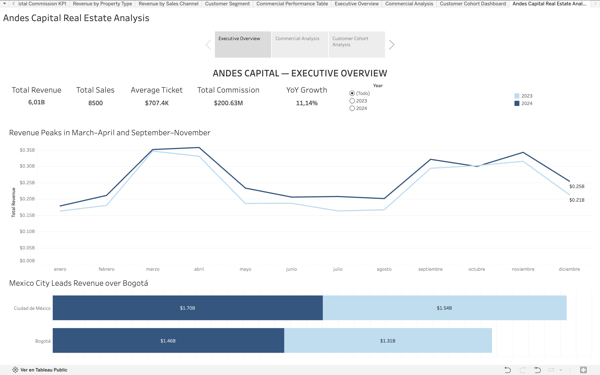
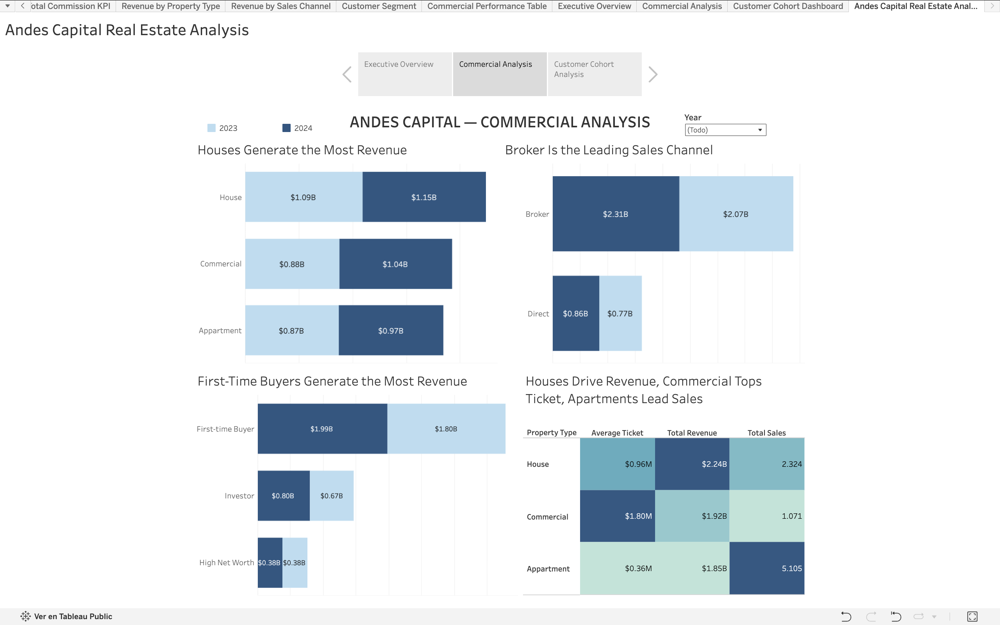
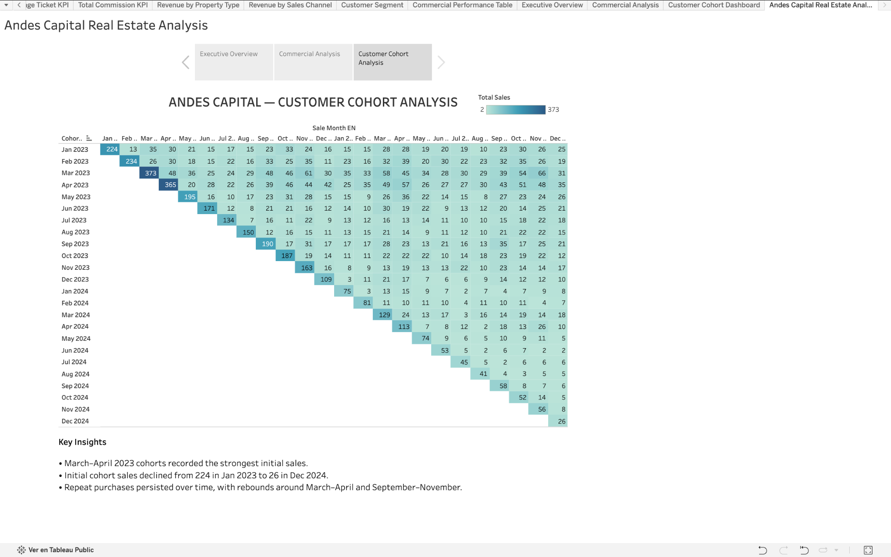

# Andes Capital Real Estate Analysis 2023–2024

**Author:** Rodrigo Garza García  
**Role:** Public & International Affairs | Business Analysis & Data Analytics  
**Portfolio:** [GitHub Profile](https://github.com/rogarzag)

Real estate commercial performance analysis and interactive Tableau story for **Andes Capital**, covering revenue, sales, property types, sales channels, customer segments, geography, time trends, and customer cohorts across 2023–2024.

## 📊 Interactive Dashboard

Explore the full interactive story on Tableau Public:

[View Dashboard on Tableau Public](https://public.tableau.com/views/AndesCapitalRealEstateDashboard/AndesCapitalRealEstateAnalysis?:language=es-ES&:sid=&:redirect=auth&:display_count=n&:origin=viz_share_link)

## 🎯 Business Objective

This project analyzes Andes Capital's real estate sales performance and identifies the commercial, geographic, customer, and time patterns associated with that performance.

Three complementary views were developed:

- **Executive Overview:** executive view of KPIs, monthly revenue trends, city performance, and YoY growth.
- **Commercial Analysis:** deeper analysis of property types, sales channels, customer segments, and commercial performance.
- **Customer Cohort Analysis:** analysis of acquisition cohorts and repeat-purchase behavior over time.

## Decision Brief

**Decision supported:** choose where to investigate channel concentration, property mix, and customer acquisition before committing commercial resources.

| Evidence from the analysis | Business implication | Recommended action | How to evaluate the next step |
|---|---|---|---|
| Brokers account for approximately 73% of revenue. | Revenue is concentrated in one channel; revenue share alone does not establish channel profitability. | Compare Broker and Direct channels on commission, acquisition cost, and contribution before testing a change in channel mix. | Monitor channel revenue share, contribution after channel costs, and acquisition cost where available. |
| Houses lead revenue, Commercial properties lead average ticket, and Apartments lead sales volume. | Category rankings reflect different commercial objectives; the highest ticket is not necessarily the best return. | Compare volume, ticket, commission, and available cost data by property type before allocating sales effort. | Track sales volume, average ticket, and contribution by property type where costs are available. |
| First-Time Buyers account for approximately 63% of revenue. | This segment is commercially important, but its revenue share does not show acquisition efficiency. | Compare acquisition cost and subsequent purchasing with other segments before expanding acquisition spend. | Monitor new-buyer sales and acquisition cost, alongside repeat-purchase rates over comparable periods. |
| Initial cohort sales range from 224 in January 2023 to 26 in December 2024. | The difference warrants investigation; sales counts alone do not demonstrate an acquisition or retention decline. | Check cohort definitions, transaction coverage, cohort size, and comparable observation windows before interpreting the pattern. | Compare acquisition counts and age-aligned repeat-purchase rates after validation. |
| Revenue peaks appear around March–April and September–November. | The two-year pattern can inform a planning hypothesis, but does not establish durable seasonality. | Compare the pattern by year, city, and property type before testing campaign timing. | Monitor monthly sales and revenue against comparable prior-year periods. |

**Suggested priority:** assess channel economics and validate the cohort comparison before expanding acquisition or changing channel investment. These actions are proposals; their effects were not measured.

## 📈 Executive Overview

### Main KPIs

| Metric | Result |
|---|---:|
| Total Revenue | **$6.01B** |
| Total Sales | **8,500** |
| Average Ticket | **$707.4K** |
| Total Commission | **$200.63M** |
| YoY Growth | **11.14%** |

## 🔎 Commercial Analysis

- **Houses** generated the highest total revenue.
- **Commercial properties** recorded the highest average ticket.
- **Apartments** led sales volume.
- The **Broker** channel generated approximately **73% of total revenue**.
- **First-Time Buyers** accounted for approximately **63% of total revenue**.

## 👥 Customer Cohort Analysis

- **March–April 2023 cohorts** recorded the strongest initial sales.
- Initial cohort sales declined from **224 in Jan 2023** to **26 in Dec 2024**.
- Repeat purchases remained present across cohorts, with rebounds around **March–April** and **September–November**.

## 💡 Key Findings

- Andes Capital generated **$6.01B in revenue** from **8,500 sales**.
- **Mexico City** generated more revenue than Bogotá.
- Revenue showed recurring peaks around **March–April** and **September–November**.
- Houses led revenue, Commercial properties led average ticket, and Apartments led sales volume.
- The Broker channel and First-Time Buyers represented the largest shares of revenue.
- Newer cohorts showed lower initial sales than early-2023 cohorts, while repeat purchasing remained visible over time.

## Interpretation & Limitations

- This project was developed within the TripleTen training program; the recommendations were not implemented.
- Revenue, sales, ticket, and commission describe commercial performance. Commission alone is insufficient to establish total costs or net profitability.
- Differences between channels, segments, and property types are descriptive associations, not causal explanations.
- Cohort sales counts are not normalized retention rates. Compare cohorts at equivalent ages and account for cohort size and available follow-up.
- Two years of observations support a tentative seasonal hypothesis, not a reliable long-term forecast.
- Monetary values follow the source workbook; currency denomination is not established in this README.

## 🛠 Tools

- Tableau Public
- Business Analysis
- Data Visualization
- KPI Analysis
- Cohort Analysis
- LOD Expressions
- Dashboard Design
- Data Storytelling

## 📓 Analysis Notebook

The portfolio version of the project notebook is available in this repository:

[`andes_capital_real_estate_analysis.ipynb`](notebook/andes_capital_real_estate_analysis.ipynb)

## 🔗 Tableau Public

[Explore the interactive workbook](https://public.tableau.com/views/AndesCapitalRealEstateDashboard/AndesCapitalRealEstateAnalysis?:language=es-ES&:sid=&:redirect=auth&:display_count=n&:origin=viz_share_link)

> The raw course dataset is not included in this repository.
